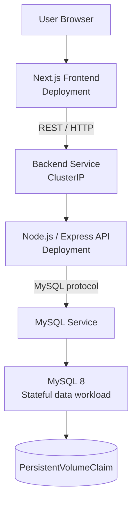
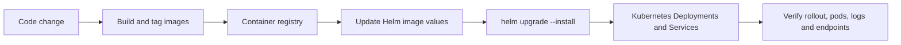

  

---

# Employee Management — Containerized Application

A practical employee-management application used to explore **containerization, Kubernetes deployments, internal service discovery, persistent database storage, and Helm-based release configuration**.

[**Repository source**](https://github.com/AhmedRaza92110/employee-management) · [Kubernetes manifests](k8s/) · [Helm chart](helm/mern-app/)

## Architecture

## Technology and infrastructure decisions

| Component | Choice | Rationale |
|---|---|---|
| Frontend | Next.js | Modern web UI and production build tooling |
| API | Node.js + Express | Simple REST boundary between UI and data |
| Database | MySQL 8 | Relational data model for employee records |
| Containers | Docker | Consistent packaging across development and deployment |
| Runtime orchestration | Kubernetes | Declarative deployments, service discovery and replica management |
| Release configuration | Helm | Reusable templates and centralized values |
| Persistent data | PVC manifest | Keeps database storage separate from pod replacement |

## Deployment workflow

This repository includes the app containers, Kubernetes YAML and Helm chart. **Automated CI/CD is not currently included in the repository**; the diagram describes the intended next-step workflow, not a pipeline that runs automatically today.

## Repository map

- `backend/` — Node.js API and container build definition.
- `frontend/employee/` — Next.js UI and multi-stage Dockerfile.
- `k8s/` — namespace, frontend/API Deployments and Services, MySQL deployment and persistence.
- `helm/mern-app/` — chart templates and configurable values.
- `rendered.yaml` — rendered manifests for review.

## Getting started

Prerequisites: Docker, Node.js/npm, kubectl, and a local Kubernetes cluster (kind, minikube, or Docker Desktop Kubernetes).

1. Inspect `k8s/` and `helm/mern-app/values.yaml`.
2. Build the frontend and API images with tags matching the manifests.
3. Load the images into your local cluster or push them to a registry.
4. Apply the namespace/manifests or install the Helm chart.
5. Confirm readiness and connectivity with `kubectl get pods,svc -n mern-devops` and inspect logs if a pod fails.

Review your selected cluster's image-pull and storage behavior before deploying; local and managed clusters differ.

## Why this design?

- **Separate tiers** make frontend and API deployments independent.
- **Internal services** give stable in-cluster DNS names and avoid exposing database traffic publicly.
- **PVC-backed database storage** demonstrates persistence concepts, although production database availability, backup and restore need more engineering.
- **Helm** makes environment-specific replica counts and image tags easier to manage.
- **Declarative manifests** provide reviewable desired state and a foundation for GitOps.

## Production hardening roadmap

- [ ] Remove committed environment files; rotate any credentials that were pushed and use Secrets/secret management.
- [ ] Replace hard-coded database root credentials with a least-privilege account.
- [ ] Add CI tests, image scanning, immutable tags and deployment approval gates.
- [ ] Add readiness/liveness probes, resource requests/limits, NetworkPolicies and TLS Ingress.
- [ ] Add monitoring, centralized logs, database backup/restore drills and rollback documentation.

> **Important:** This is a learning/portfolio deployment foundation, not a claim of a fully production-hardened or highly available platform.

Cloud-native fundamentals, documented transparently.

